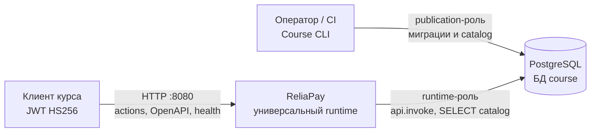
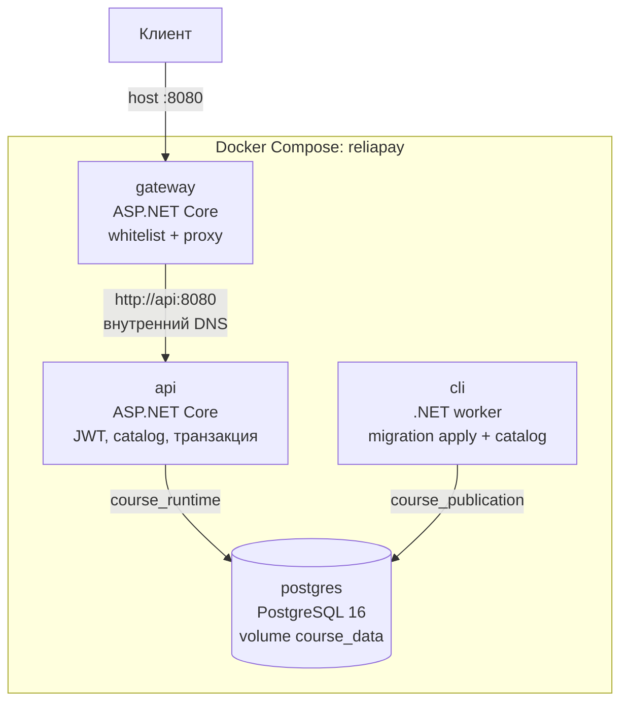

# C4: ReliaPay, неделя 1

Два уровня: контекст системы и контейнеры Compose. Компонентный уровень C# намеренно не рисуется здесь — его роль описана в [ADR-0001](adr/0001-trust-boundary.md).

## Уровень 1. Контекст

Внешний клиент (автопроверка, интеграционные тесты, ручной `curl`) обращается только к ReliaPay. PostgreSQL — часть системы, не отдельный SaaS. Операции публикации выполняет человек или CI через Course CLI, а не через публичный HTTP.

Клиент не видит имена функций, схемы и SQL. Он выбирает только `module` / `action` и JSON-payload.

## Уровень 2. Контейнеры

Четыре процесса Docker Compose. На хост опубликован только порт gateway `8080`.

| Контейнер | Технология | Ответственность | Порт на хост |
| --- | --- | --- | --- |
| `gateway` | ASP.NET Core / .NET 10 | Единственный вход, whitelist, прокси, live/ready | `8080` |
| `api` | ASP.NET Core / .NET 10 | JWT, schema, OpenAPI из catalog, `api.invoke` | нет |
| `cli` | .NET 10 runtime | Checksum-миграции при старте, команды catalog | нет |
| `postgres` | PostgreSQL 16 | БД `course`, роли, WAL, named volume | нет |

Направление вызовов неизменно: клиент → gateway → api → PostgreSQL.

`api` зависит от healthy `cli` (миграции уже применены) и healthy `postgres`. `gateway` зависит от healthy `api`.

## Что контейнеры сознательно не делают

| Контейнер | Не делает |
| --- | --- |
| `gateway` | Не проверяет JWT, не читает catalog, не открывает Npgsql |
| `api` | Не применяет миграции, не вызывает `publish_action`, не берёт publication-пароль |
| `cli` | Не слушает HTTP и не исполняет клиентские actions |
| `postgres` | Не публикует порт на хост в учебной конфигурации |

Подробности границы доверия — [ADR-0001](adr/0001-trust-boundary.md). Различие HTTP-конверта и outcome функции — [ADR-0002](adr/0002-technical-vs-domain-result.md).
