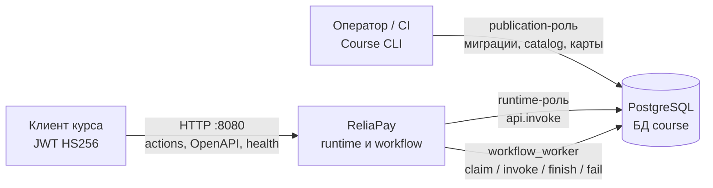
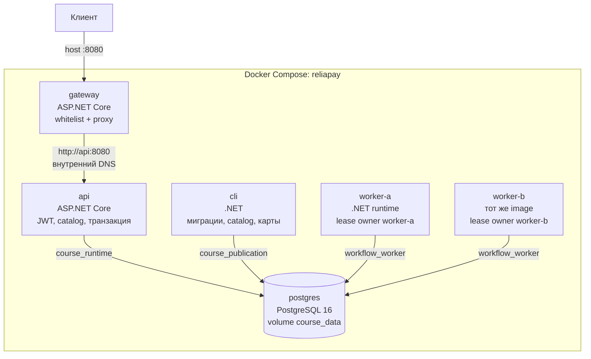

# C4: ReliaPay, недели 1 и 2

Два уровня: контекст системы и контейнеры Compose. Компонентный уровень C# намеренно не рисуется здесь — его роль описана в [ADR-0001](adr/0001-trust-boundary.md) и [ADR-0003](adr/0003-worker-lease-transaction.md).

## Уровень 1. Контекст

Внешний клиент (автопроверка, интеграционные тесты, ручной `curl`) обращается только к ReliaPay. PostgreSQL — часть системы, не отдельный SaaS. Операции публикации выполняет человек или CI через Course CLI, а не через публичный HTTP. Generic worker исполняет automatic-шаги внутри сети Compose.

Клиент не видит имена функций, схемы и SQL. Он выбирает только `module` / `action` и JSON-payload. Worker не читает catalog таблицами: манифест приходит из `claim_jobs`.

## Уровень 2. Контейнеры

Шесть процессов Docker Compose. На хост опубликован только порт gateway `8080`. `worker-a` и `worker-b` — два экземпляра одного образа.

| Контейнер | Технология | Ответственность | Порт на хост |
| --- | --- | --- | --- |
| `gateway` | ASP.NET Core / .NET 10 | Единственный вход, whitelist, прокси, live/ready | `8080` |
| `api` | ASP.NET Core / .NET 10 | JWT, schema, OpenAPI из catalog, `api.invoke` | нет |
| `cli` | .NET 10 runtime | Checksum-миграции, catalog и `flow` | нет |
| `worker-a` | .NET 10 runtime | Claim/invoke/finish/fail, owner `worker-a` | нет |
| `worker-b` | тот же image | То же, owner `worker-b` | нет |
| `postgres` | PostgreSQL 16 | БД `course`, роли, WAL, named volume | нет |

Направление HTTP неизменно: клиент → gateway → api → PostgreSQL. Worker ходит в PostgreSQL напрямую ролью `workflow_worker`, минуя HTTP.

`api` и оба worker зависят от healthy `cli` (миграции уже применены) и healthy `postgres`. `gateway` зависит от healthy `api`.

## Что контейнеры сознательно не делают

| Контейнер | Не делает |
| --- | --- |
| `gateway` | Не проверяет JWT, не читает catalog, не открывает Npgsql |
| `api` | Не применяет миграции, не вызывает `publish_action` / `publish_flow`, не берёт publication-пароль |
| `cli` | Не слушает HTTP и не исполняет job |
| `worker-a` / `worker-b` | Не делают table DML, не читают catalog SELECT, не публикуют порт |
| `postgres` | Не публикует порт на хост в учебной конфигурации |

Подробности границы доверия — [ADR-0001](adr/0001-trust-boundary.md). Различие HTTP-конверта и outcome функции — [ADR-0002](adr/0002-technical-vs-domain-result.md). Lease и транзакция worker — [ADR-0003](adr/0003-worker-lease-transaction.md).
